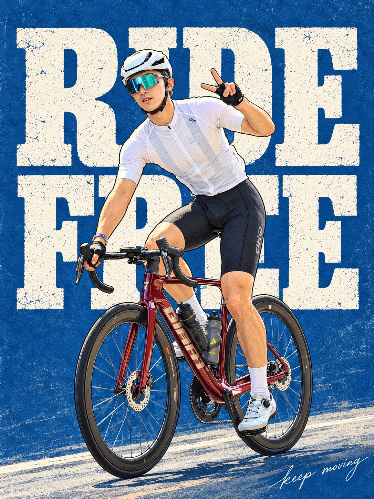
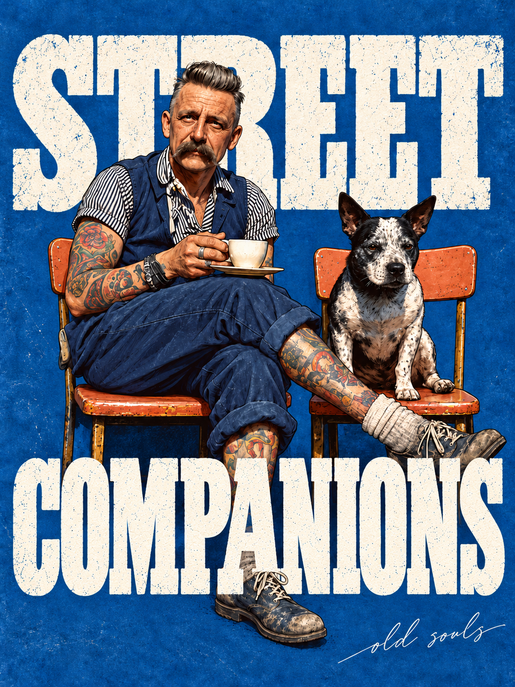
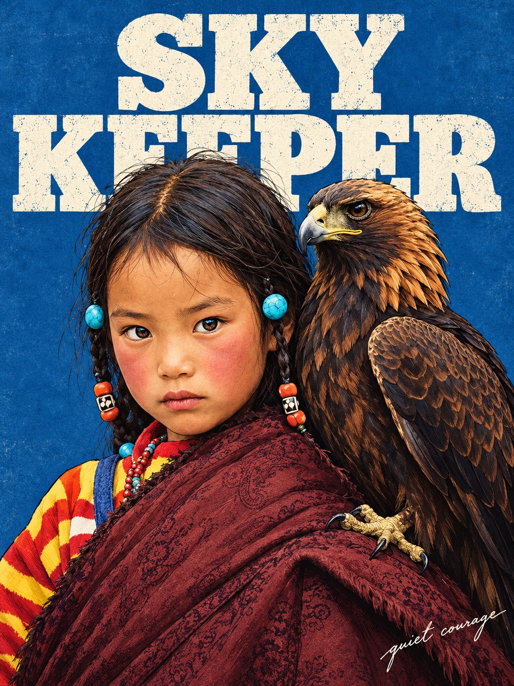

# 麻花·日系生活插画海报

一个面向 Codex 的图片创作 Skill：把人物照片重绘为日系生活杂志感的半写实插画海报。

默认输出为 3:4 竖版，使用中深丹宁蓝纸纹、米白色复古板状衬线英文大标题，以及右下角纤细英文手写装饰词。支持标题前置、后置、前后交错和局部穿插。

## 特点

- 保留人物脸型、五官关系、年龄、发型、体型、服装、表情、动作与关键道具
- 半写实插画重绘，不使用照片贴脸或统一网红脸
- 自动根据画面拟定简短英文标题和手写装饰词
- 支持自然语言修改标题层次、底色、比例、语言和装饰词
- 多张照片分别输出，不拼接成一张

## 案例

| RIDE FREE | COFFEE TOGETHER |
| --- | --- |
|  |  |

| STREET COMPANIONS | SKY KEEPER |
| --- | --- |
|  |  |

## 安装

将本仓库克隆或复制到 Codex Skills 目录：

```bash
git clone https://github.com/245331830gao-alt/mahua-everyday-illustration-poster.git ~/.codex/skills/mahua-everyday-illustration-poster
```

重新打开 Codex 后即可使用。

## 使用

上传一张人物照片并输入：

```text
使用 $mahua-everyday-illustration-poster，把这张照片制作成日系生活插画海报。
```

也可以直接指定排版：

```text
大标题放在人物后面，右下角写 little moments。
```

```text
第一行标题在后，第二行在前，其他保持不变。
```

## 目录结构

```text
mahua-everyday-illustration-poster/
├── SKILL.md
├── agents/
│   └── openai.yaml
├── assets/
│   ├── approved-behind.jpg
│   └── approved-mixed.jpg
├── examples/
│   ├── coffee-together.png
│   ├── ride-free.png
│   ├── sky-keeper.png
│   └── street-companions.png
└── references/
    └── style-and-prompts.md
```

## 说明

- 本仓库提供工作流、视觉规范和参考资产，需要宿主环境具备图像输入与图像生成能力。
- 用户应只处理自己拥有或已获授权使用的照片，并遵守适用的肖像权、隐私权和版权规则。
- 参考图只用于画风和排版，不应把参考图人物当作用户本人，也不应复制参考图中的签名。

## License

[MIT](LICENSE)
